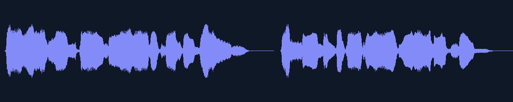

# Narrate AI

**Turn personal photos, videos, and voice memos into narrated documentaries.**


Narrate AI analyzes media, drafts a story arc, synthesizes narration, adds music and ambient audio, and assembles a video through a four-step Streamlit workflow.

[Output preview](#output-preview) · [Features](#features) · [Quick start](#quick-start) · [Usage](#usage) · [Evaluation](#evaluation) · [Documentation](#documentation)

## Output preview

### Narration sample

The waveform below comes from a saved **7.56-second narration test**. Click it to open the WAV file.

[](docs/media/narration.wav)

[Open or download the narration audio](docs/media/narration.wav)

### Generated script

A separate saved script, **Into the Unknown**, defines three narrative beats with emotion, pacing, music, and ambient-sound instructions.

| Act | Emotion | Suggested duration | Cut speed |
|---|---|---:|---|
| Setup | Excited | 5 seconds | Medium |
| Peak | Joyful | 5 seconds | Fast |
| Reflection | Nostalgic | 5 seconds | Slow |

Opening narration from the saved script:

> As I stand here, the world stretches out before me like an endless canvas, waiting to be explored. The thrill of the unknown beckons, a siren's call to adventure. I take my first step, and the journey begins.

[View the complete script JSON](docs/media/sample-script.json)

These samples demonstrate saved intermediate outputs. A rendered documentary video is not included yet; the narration test and script are separate samples.

## Features

- **Media understanding:** Analyze photos and video frames with CLIP; transcribe voice memos with Whisper.
- **Script choices:** Generate three script variants, or supply your own narration text.
- **Narration:** Chatterbox TTS with an optional reference voice.
- **Soundtrack controls:** Select music mood and ambient scene, then adjust narration, music, and ambient volumes.
- **Video assembly:** Combine selected media, motion effects, transitions, and mixed audio into an MP4.

## Quick start

### Requirements

- Python 3.10 or later.
- FFmpeg: `brew install ffmpeg` on macOS or `sudo apt install ffmpeg` on Ubuntu/Debian.
- At least 8 GB RAM; 16 GB or more and a GPU are recommended for the local models.

### Installation

```bash
git clone https://github.com/sayushmaharjan/narrate-ai.git
cd narrate-ai
python -m venv .venv
source .venv/bin/activate
pip install -r requirements.txt
cp .env.example .env
```

On Windows, activate the environment with `.venv\Scripts\activate`.

Set `GROQ_API_KEY` in `.env` for the default narrative provider. To use Anthropic, set `ANTHROPIC_API_KEY` and change `LLM_PROVIDER` in [config.py](config.py). Without a configured key, the narrative stage uses a template fallback.

```bash
streamlit run app.py
```

Open `http://localhost:8501`.

## Usage

### Web interface

1. **Upload:** Add photos, video clips, and optional voice memos or a voice reference.
2. **Analyze:** Extract media descriptions and generate script options.
3. **Customize:** Select a script, music mood, ambient scene, and audio levels.
4. **Export:** Render and download the documentary.

### Python pipeline

The same two-stage pipeline used by the interface can be called directly:

```python
from pipeline.orchestrator import run_pipeline_pre, run_pipeline_finalize

preview = run_pipeline_pre(
    photo_video_paths=["beach.jpg", "holiday.mp4"],
    audio_paths=["voice_memo.m4a"],
    output_dir="outputs",
    event_hint="vacation",
    target_duration_s=60,
)

result = run_pipeline_finalize(
    pre_result=preview,
    selected_version=0,
    music_mood="cinematic",
    ambient_scene="beach",
    # voice_reference_path="my_voice.wav",  # Optional
)
print(result["output_video_path"])
```

Replace the example paths with your own media files. Provider credentials are read from `.env` through `config.py`.

## How it works

```text
Photos / videos / voice memos
    --> Visual analysis + transcription
    --> Script variants + story arc
    --> Selected narration + music + ambient track
    --> Audio mixing + video assembly
    --> MP4 + script JSON + intermediate audio
```

| Stage | Main tools |
|---|---|
| Visual analysis | CLIP, OpenCV |
| Transcription | Whisper |
| Narrative | Groq or Anthropic, with a template fallback |
| Narration | Chatterbox TTS |
| Music | MusicGen |
| Video | MoviePy, FFmpeg |
| Interface | Streamlit |

## Evaluation

```bash
python evaluate_speech.py
```

This script synthesizes narration, transcribes it, and reports word error rate, transcription accuracy, and timing. Its SIM-R and CLAP values are simulated demonstration scores, not measured model benchmarks.

## Documentation

- [Technical documentation](DOCUMENTATION.md): architecture, module reference, configuration, and limitations.
- [Configuration](config.py): providers, model identifiers, audio levels, and output paths.
- [Sample provenance](docs/media/README.md): source and format of the included previews.
- [Dependencies](requirements.txt).
